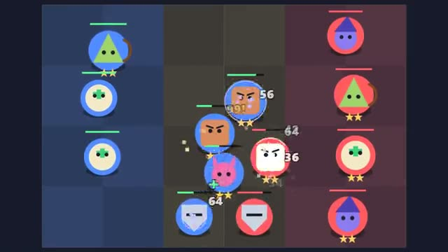

# Auto Arena

Buy units, place them, watch them fight. A multiplayer starter game from [Multiplayer Agent](https://multiplayeragent.com): 2D, versus, 2–8 players, with bots that take the empty seats.

## How it plays

Between rounds, spend gold on units and drag them onto your board. Then they fight another player's army on their own. Lose and you lose health; three of a kind merge into a stronger unit. Last one standing wins.

**Controls:** Tap a shop card to buy, drag units to place them, drag a unit onto the shop to sell.

## Make it yours in the Game Builder

Open the [Game Builder](https://multiplayeragent.com), choose **Start from a starter game** and pick Auto Arena. It opens as version 1 in your studio, ready to play and publish. Then ask for changes, for example:

- Add a unit that summons small skeletons
- Give units teams like Fire and Ice with a bonus for three of a team
- Make it a space battle with ships instead of units

## Run it yourself

1. Get a free publishable key (`pk_…`) at [multiplayeragent.com](https://multiplayeragent.com).
2. In `index.html`, put it in place of `pk_REPLACE_ME` in the `MP_CONNECT` block.
3. Open `index.html` in a browser. No build step and no server needed.

Without a key it still runs, offline against bots.

## How it is built

- One `index.html`. The comment at the top of the script maps the code and explains the multiplayer.
- **Host-run rounds:** The host's browser runs the shop timer, pairs everyone up and works out every fight; if it leaves, the next player takes over.
- **Live sync:** Every screen replays the same fight from the same boards and seed, so everyone sees the same battle.
- **Bots:** Bots take the empty seats and shop for themselves, and a friend who joins takes over a bot's army.
- **Leaderboard:** Most games won, shown on the results card.
- `?attract` runs it offline, bots only, with big armies. The preview video is recorded from it.

## License

MIT.
